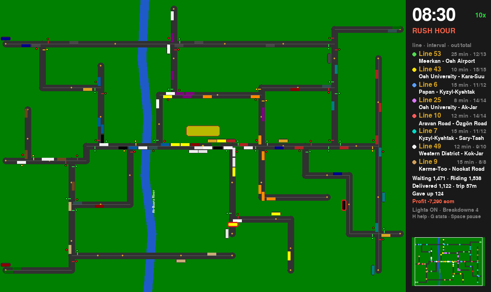
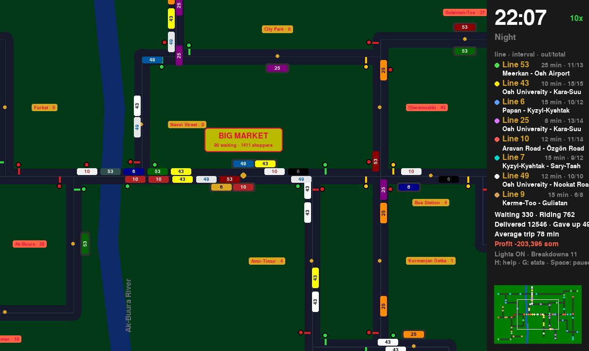
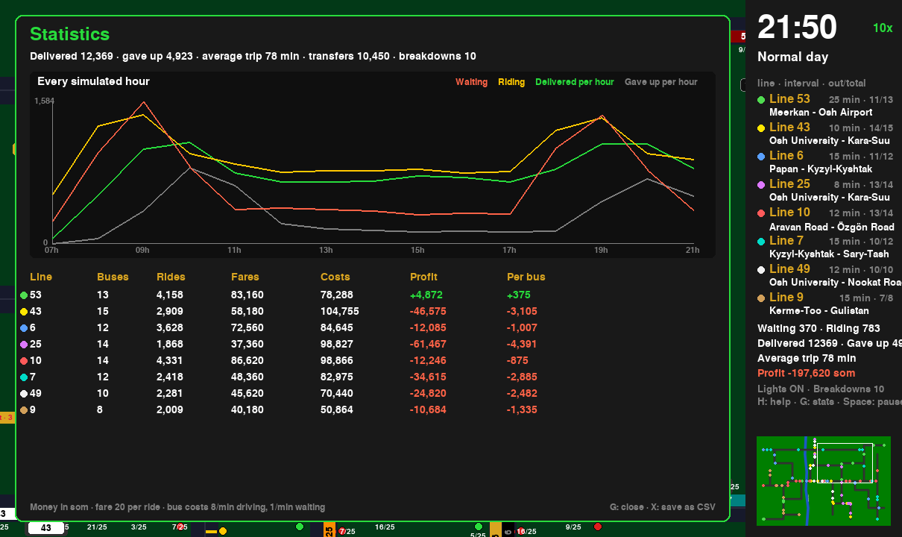
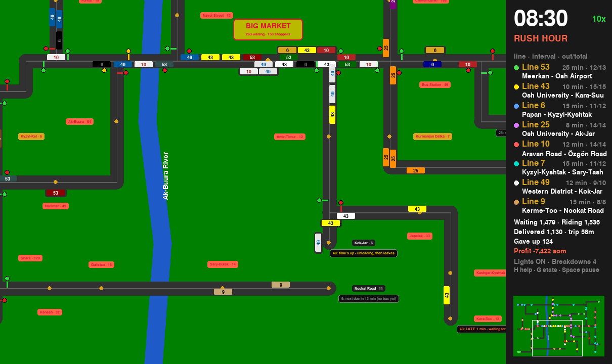
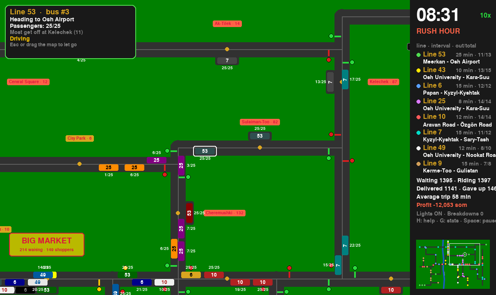

# Osh Bus Simulator

A simulation of city buses in Osh, Kyrgyzstan, built in Python with Pygame.

Eight bus lines run between terminals across the city. Passengers show up at stops, plan their trips, transfer at the Big Market, and give up if they wait too long. Dispatchers keep buses on schedule, traffic lights control the crossings, buses break down, and every line earns and spends money.



## The story

Three years ago I built an animation of buses in HTML and CSS. Every turn was a hand-tuned keyframe, and every bus was a copy-pasted `div` with its own `animation-delay`. That code is still here in [`original-css/`](original-css/).

The buses looked real, but they didn't know anything. They couldn't stop for passengers, wait for a green light, or run late. This project rebuilds them as a real simulation: every bus, stop, line, and passenger is an object that follows rules, and the city's behavior comes out of those rules. Bus bunching, traffic jams at the market, and overloaded lines were never programmed directly; they just happen.

## Run it

You need Python 3.10+.

```
pip install -r requirements.txt
python bus_sim.py
```

On Windows you can use `py` instead of `python`.

## Controls

| Key | Action |
|---|---|
| Arrows / WASD / drag | Move the camera |
| Mouse wheel, + / -, Q / E | Zoom |
| Click the minimap | Jump anywhere |
| Click a bus | Follow it and see what it's doing (Esc lets go) |
| Space | Pause / continue |
| 1  2  3  4 | Speed 1x, 2x, 5x, 10x |
| L | Traffic lights on / off |
| G | Statistics: hourly chart + money per line |
| X | Save statistics as CSV files |
| H | Help |

Time scale: 1 real second = 1 simulated minute at 1x speed. The day starts at 06:00.

## The lines

| Line | Route | Every |
|---|---|---|
| 53 | Meerkan – Big Market – Osh Airport | 25 min |
| 43 | Osh University – Big Market – Kara-Suu | 10 min |
| 6 | Papan – Big Market – Kyzyl-Kyshtak | 15 min |
| 25 | Osh University – Cheremushki – Ak-Jar (skips the market) | 8 min |
| 10 | Aravan Road – Big Market – Özgön Road | 12 min |
| 7 | Kyzyl-Kyshtak – Kelechek – Sary-Tash (skips the market) | 15 min |
| 49 | Western District – Big Market – Kok-Jar | 12 min |
| 9 | Kerme-Too – Gulistan – Nookat Road | 15 min |

Stop names like Teshik-Tash, Surot-Tash, and Dacha 1 come from the original CSS version.

Change the number of buses, the interval, speed, or seats for any line in the `make_line(...)` calls near the bottom of `bus_sim.py`.

## How it works

- **Buses** follow a list of corner points instead of keyframes. A bus moves a few pixels toward its next corner every frame, and drives on the right side of the road.
- **Dispatchers** at each terminal send buses out at a fixed interval, first come, first served. The countdown starts only when a bus actually pulls out, and a late bus leaves right away.
- **Passengers** pick a destination (busy places are more popular) and plan a route with at most one transfer. They take whichever bus comes first if more than one works, and give up after 90 minutes of waiting.
- **Traffic lights** are placed automatically wherever three or more streets meet.
- **Bus bays** let buses pull over at stops, so traffic keeps moving.
- **Money:** every ride pays a fare, and every bus costs money per minute, more when driving than when waiting.
- **The camera** draws the static city once onto a big background, then shows only the visible part, scaled by the zoom.

## Screenshots

| Night | Statistics |
|---|---|
|  |  |

| The Big Market | Following a bus |
|---|---|
|  |  |

## Ideas for later

- Smart dispatcher that holds buses to prevent bunching
- Bus priority at traffic lights
- Cars and taxis on the roads, winter, weekends
- A route editor to draw new lines with the mouse
- Real street map of Osh from OpenStreetMap
- Split the code into modules and add tests
